# 🔐 Week 13 – Microsoft Entra ID as the Identity Provider: SAML SSO App Onboarding

In this lab, I onboarded a SaaS application to **Microsoft Entra ID using SAML 2.0 single sign-on**, with **Entra ID as the identity provider (IdP)**. That's the day-to-day IAM task of connecting a new business app so employees sign in with their corporate identity.

My earlier SSO labs used Okta as the IdP ([Week 12](../Week-12-OktaxSalesforce-JML)) and Entra as the *service provider* ([Week 8](../week%208)). This lab completes the picture: **Entra issuing the assertion**, which is how most Microsoft-centric enterprises run SSO.

> **Bottom line:** Entra-side configuration complete. I also found and fixed a certificate trust mismatch and enforced access through assignment. The final end-to-end test hit a server-side error inside the third-party test app, and I used Entra's sign-in logs to isolate where it failed (see [Issue 4](#issue-4--the-app-threw-a-server-error-at-sign-in)).

---

## 🏢 Scenario

*Harbor Claims Group* (fictional) is a claims and risk management company. The claims operations team bought a new SaaS case-management tool that will hold **claimant PII and health information**. The ticket assigned to the IAM team:

1. Staff must sign in with their **corporate Entra ID account**. No separate app passwords.
2. **Only approved staff** may get in. Everyone else is blocked at the identity layer.
3. Sign-ins must be **logged** for audit and incident response.
4. The integration must not break when signing certificates expire.

I played the IAM analyst on that ticket. The **Microsoft Entra SAML Toolkit** (Microsoft's test SAML app in the Entra gallery) stood in for the vendor's app.

---

## 🧠 Key Concepts

| Term | What it means in this lab |
|---|---|
| **IdP (identity provider)** | Microsoft Entra ID. Authenticates the user and issues the signed SAML assertion. |
| **SP (service provider)** | The SAML Toolkit app. Trusts Entra and consumes the assertion. |
| **Identifier (Entity ID)** | The app's unique name. Must match exactly on both sides. |
| **Reply URL / ACS URL** | Where Entra posts the signed assertion. Must match exactly on both sides. |
| **NameID (Unique User Identifier)** | The value the app uses to recognize the user. Here, the UPN in email format. |
| **Token signing certificate** | Entra signs assertions with its **private key**. The app verifies them with Entra's **public certificate**. |
| **Service principal (enterprise app)** | The app's instance in *my* tenant: where assignment, SSO settings, and sign-in logs live. |
| **Application ID vs Object ID** | The Application ID is the same in every tenant. The Object ID is unique to each tenant's service principal. |
| **SP-initiated vs IdP-initiated** | The user starts at the app (SP) or at My Apps (IdP). When a Sign-on URL is set, My Apps launches the app SP-initiated. |

---

## 🔄 SAML Flow (SP-initiated)

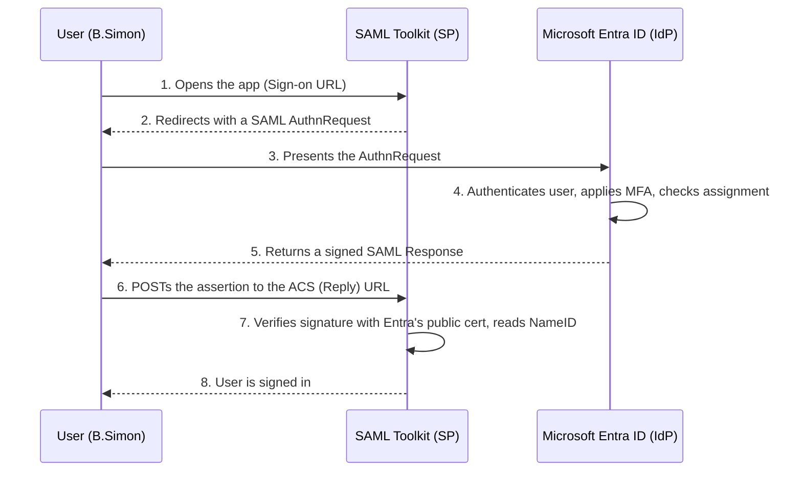

---

## 🧰 Environment

- **Tenant:** ByteKage lab tenant, **Microsoft Entra ID Free**
- **App:** Microsoft Entra SAML Toolkit (gallery app), renamed `SAML Toolkit-Lab`
- **Test user:** `B.Simon`
- **Admin role used:** Global Administrator *(lab only; see [Production Hardening](#-production-hardening))*

---

## 🛠️ Build Steps

### Step 1 – Check the license and role before building
Before onboarding anything, I confirmed what the tenant's license allows. On the **Free** tier, SAML SSO for gallery apps works, but **group-based assignment and Conditional Access need P1**. My earlier P2 trial had expired, and premium-only pages returned a 401.

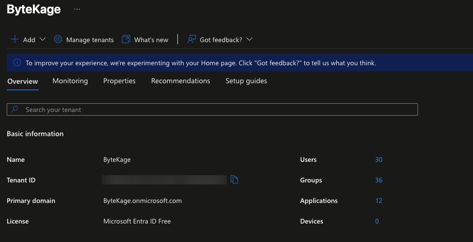
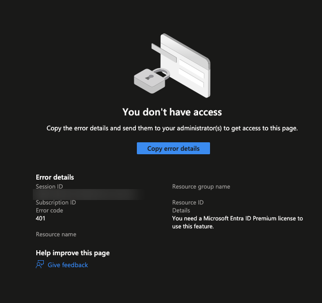

### Step 2 – Add the app from the Entra gallery
**Entra ID → Enterprise apps → New application →** *Microsoft Entra SAML Toolkit*. Adding it creates a **service principal** in my tenant. Gallery apps come with the vendor's SAML settings already filled in, so I check the gallery before building a custom app.

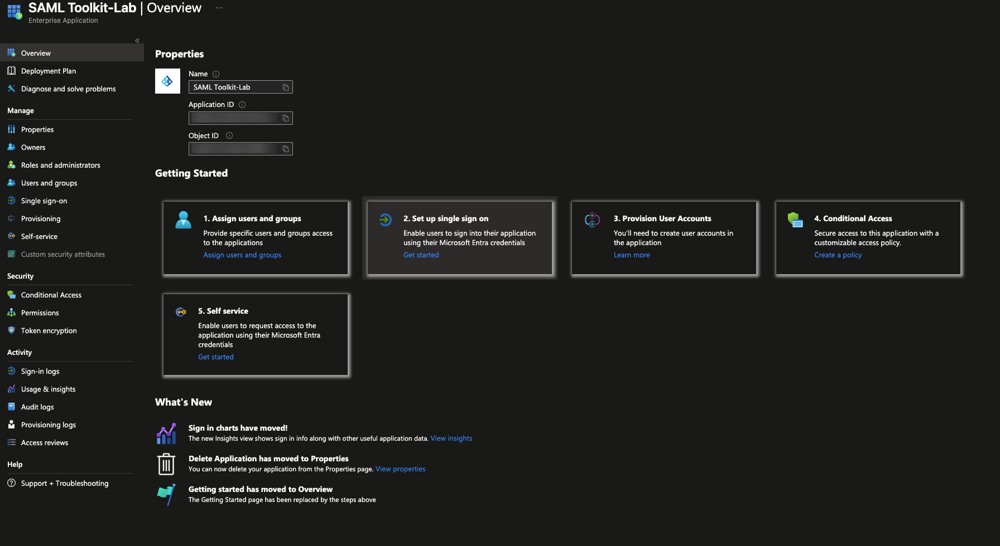

### Step 3 – Configure SAML on the Entra side
**Single sign-on → SAML.**
- **Basic SAML Configuration:** Identifier, Reply (ACS) URL, Sign-on URL
- **Attributes & Claims:** Unique User Identifier (NameID) = `user.userprincipalname`. This app requires the NameID format **Email address**, which is a key check if sign-in fails after Entra.
- **SAML Certificates:** noted the expiry date and the notification email, downloaded Certificate (Raw)
- **Set up section:** copied the Login URL, Microsoft Entra Identifier, and Logout URL for the app side

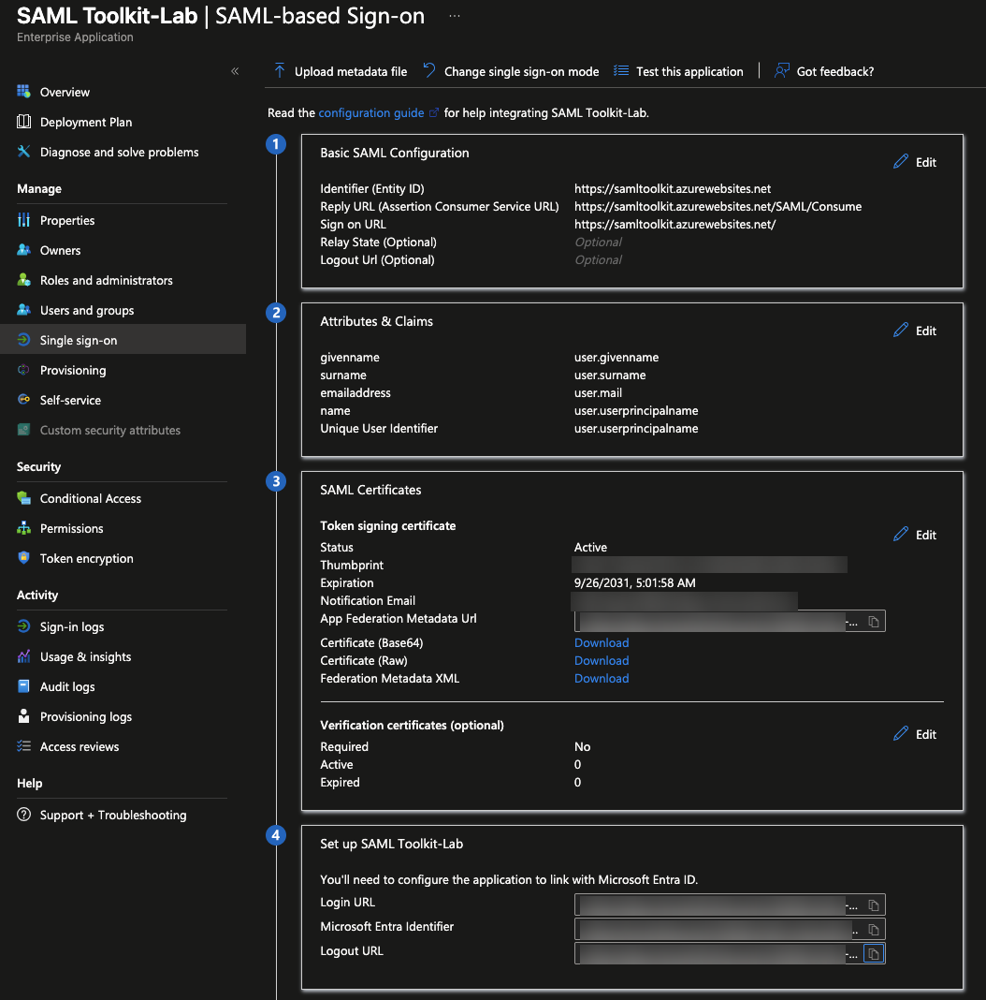

### Step 4 – Configure the app side and match the values exactly
In the SAML Toolkit, I created an SSO configuration using Entra's Login URL, Identifier, Logout URL, and signing certificate. The toolkit returned its own **ACS URL** and **Sign-on URL**, which I entered back in Entra. Both sides must match character for character.

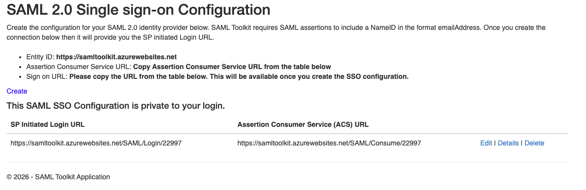
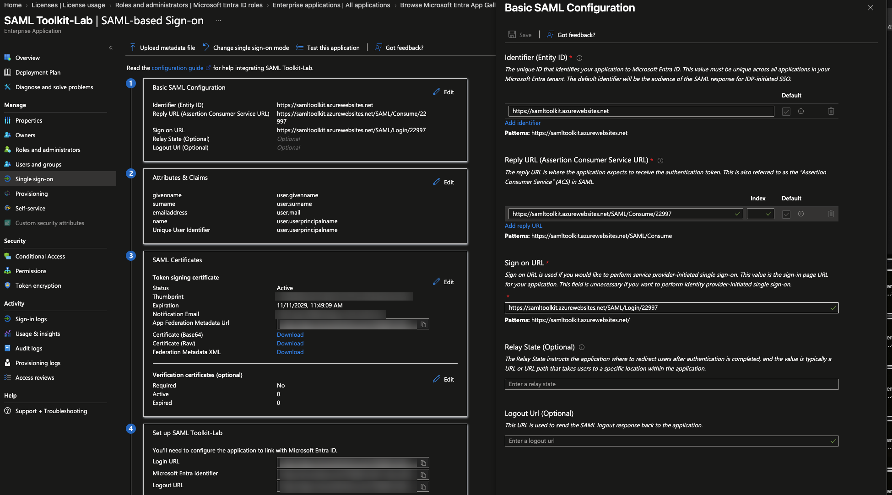

After rebuilding the trust (see [Issue 2](#issue-2--the-app-trusted-the-wrong-signing-certificate)), the final configuration was connection `22998`:

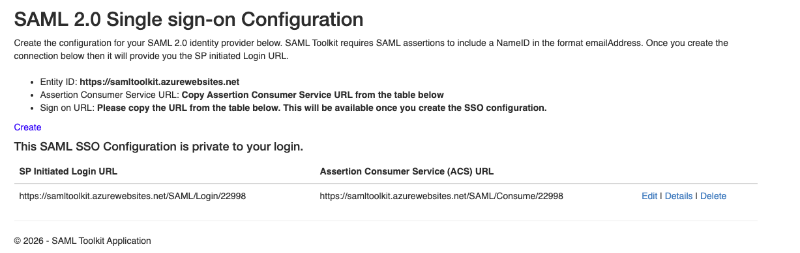
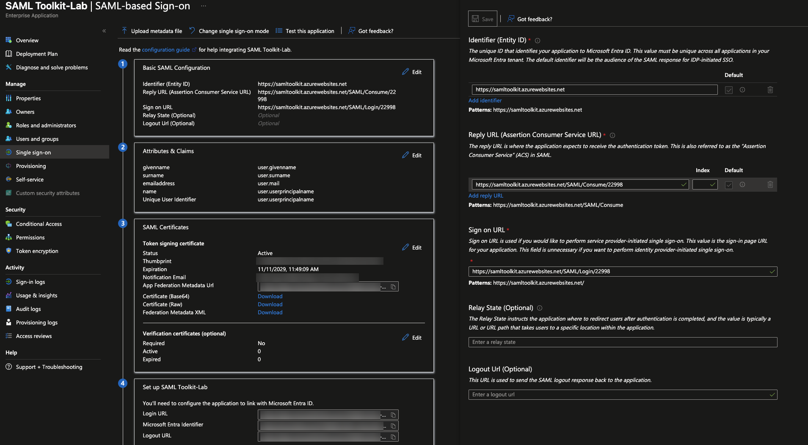

### Step 5 – Restrict access with assignment
- **Properties → Assignment required? = Yes.** Entra won't issue a token to anyone who isn't assigned (error **AADSTS50105**).
- Assigned **B.Simon** directly. Group assignment needs P1; in production I'd assign a security group tied to the joiner/mover/leaver process.

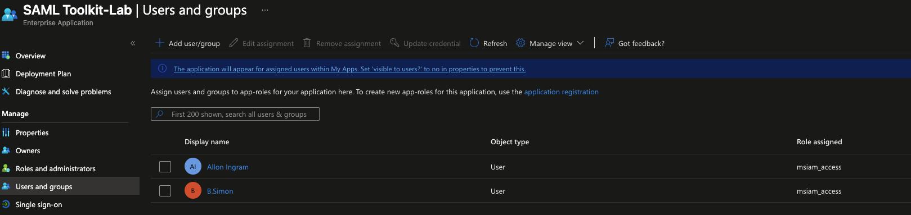

### Step 6 – Test the sign-in paths
- Signed in to **My Apps** as B.Simon. The **SAML Toolkit-Lab tile appears only for assigned users** ✅
- The tile launched the app **SP-initiated**, because a Sign-on URL is configured, and loaded the toolkit's login page for connection `22998` ✅
- Clicking **Log in** returned a **server error from the toolkit's own site** ❌ (see [Issue 4](#issue-4--the-app-threw-a-server-error-at-sign-in))

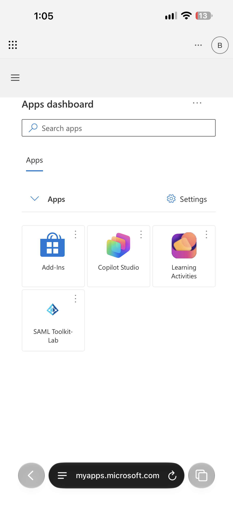
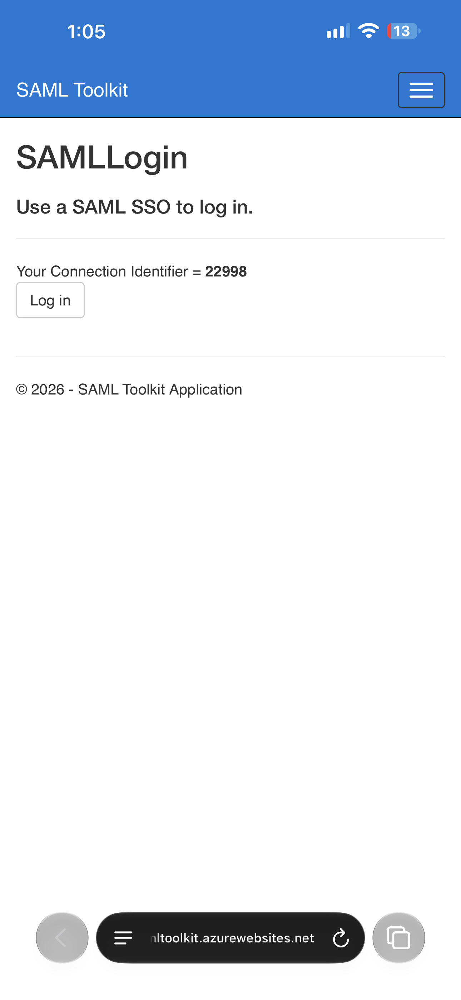

---

## 🧯 Issues I Hit and How I Solved Them

### Issue 1 – The certificate download was grayed out
**Cause:** Entra doesn't generate the app's SAML signing certificate until the Basic SAML Configuration has been saved. That creates a catch-22: the app needs Entra's certificate, and Entra needs the app's values.
**Fix:** Saved Basic SAML Configuration with known and temporary values, which generated the certificate. Then I finished the app side and updated Entra with the final values.

### Issue 2 – The app trusted the wrong signing certificate
**Symptom:** The active signing certificate's thumbprint and expiry in Entra no longer matched the certificate I had uploaded to the app.
**Investigation:** I compared the certificate details on both sides. The app held a certificate issued to `accounts.accesscontrol.windows.net`, most likely the tenant-level signing key Entra showed before the app-specific certificate existed. Entra was now signing with a newly generated **app-specific** certificate.
**Impact if missed:** signature validation fails at the SP and **nobody can sign in**. It's the same outage that happens in production when a SAML certificate rotates and the vendor isn't updated.
**Fix:** Downloaded the active certificate, checked its subject and expiry before uploading, and re-established trust on the app side.

### Issue 3 – The app's "edit" feature errored while replacing the certificate
**Fix:** Deleted the app-side configuration and recreated it with the active certificate. The new configuration (`22998`) came with new ACS and Sign-on URLs, so I updated Entra's Reply URL and Sign-on URL to match and removed the old Reply URL.

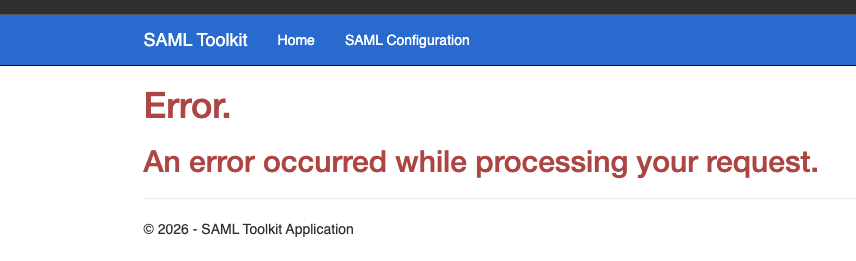

### Issue 4 – The app threw a server error at sign-in
**Symptom:** An ASP.NET "Server Error in '/' Application" page from the toolkit's site. Errors from Entra always carry an **AADSTS** code, so this pointed at the app, not Entra.
**Method: find which side broke.**
1. **Before Entra:** the app fails before redirecting, so there's **no sign-in event** in Entra.
2. **At Entra:** the sign-in log shows a **failure with an AADSTS code**.
3. **After Entra:** the sign-in log shows **Success**, which means the assertion was issued and the SP failed to process it. Next suspects: the NameID format and the certificate format.

**Log check result:** _(update after checking: Entra ID → Monitoring → Sign-in logs → filter B.Simon)_

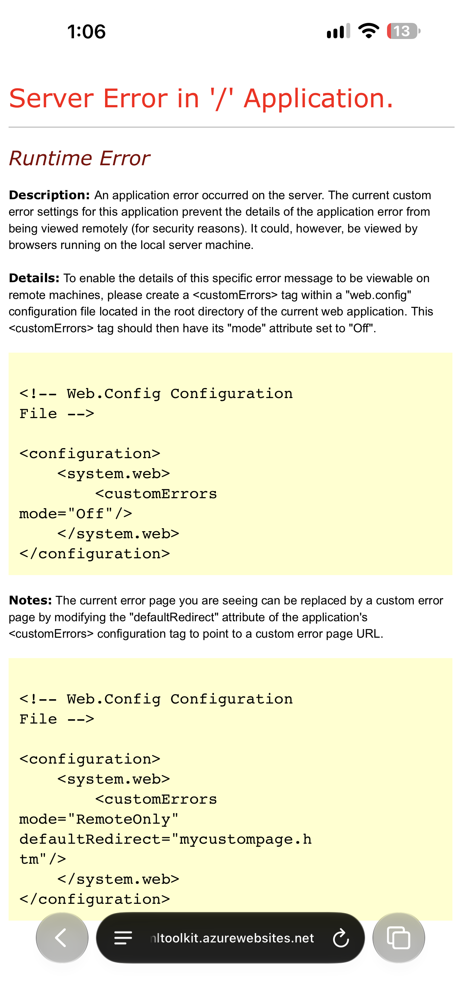

---

## 🛡️ Production Hardening

What I'd do differently in a real enterprise tenant:

- **Least privilege:** do the work as **Cloud Application Administrator**, activated just-in-time through **PIM**, not Global Admin.
- **Group-based assignment (P1):** assign a security group fed by the joiner/mover/leaver process, so access follows role changes automatically. Remove admins who were auto-assigned when they created the app.
- **MFA:** a **Conditional Access** policy targeting the app (P1). On a free tenant, **security defaults** enforce MFA registration and prompts.
- **Certificate lifecycle:** send the notification email to a **team distribution list**, not one person. Track SAML certificate expirations across all apps, and rotate ahead of time: create the new certificate, give it to the vendor, then activate it at an agreed cutover.
- **Deprovisioning:** add **SCIM provisioning** where the app supports it, so disabling a user in Entra also disables the account in the app.
- **Monitoring:** alert on **unexpected certificate or federation setting changes** in the audit logs.

---

## 📋 NIST SP 800-53 Rev. 5 Alignment

*This lab shows control alignment, not a formal compliance assessment.*

| Control | What it asks for | How this lab supports it |
|---|---|---|
| **AC-2** Account Management | Manage who has accounts and access | Access granted by assignment; in production, through JML-driven group membership |
| **AC-3** Access Enforcement | Enforce approved authorizations | `Assignment required = Yes`: Entra blocks unassigned users (AADSTS50105) |
| **AC-6** Least Privilege | Only the access needed | Cloud Application Administrator through PIM instead of Global Admin; remove unneeded assignments |
| **IA-2** Identification & Authentication (Organizational Users) | Uniquely identify and authenticate users; MFA (IA-2(1), IA-2(2)) | Users authenticate once with their corporate identity; MFA through security defaults or Conditional Access |
| **IA-5(2)** Public Key-Based Authentication | Validate certificates and manage the keys behind them | SP validates assertions against Entra's public certificate; certificate expiry and rotation tracked |
| **SC-12** Cryptographic Key Establishment & Management | Protect and manage cryptographic keys | Signing private key never leaves the IdP; planned rotation process |
| **SC-23** Session Authenticity | Protect the authenticity of sessions | Signed assertions prove they came from Entra and weren't altered |
| **AU-2 / AU-6 / AU-12** Audit Events, Review & Generation | Log, review, and analyze security events | Sign-in and audit logs used to validate access and isolate the failure in Issue 4 |
| **CM-3** Configuration Change Control | Control and coordinate changes | Certificate rotation coordinated with the vendor; changes recorded in audit logs |
| **SA-9** External System Services | Govern third-party services | SaaS app integrated under the organization's identity controls instead of standalone app passwords |

---

## 🧪 CySA+ Connections

- **Security Operations:** IAM concepts in practice: SSO, federation, SAML, MFA, and reading sign-in logs.
- **Incident Response:** whoever holds the IdP's signing private key can forge SAML tokens for any user. That's **Golden SAML**, MITRE ATT&CK **T1606.002 (Forge Web Credentials: SAML Tokens)**. Detection starts with unexpected certificate or federation changes in audit logs, and sign-ins that don't match a real authentication.
- **Vulnerability Management:** identity misconfigurations are attack surface: `Assignment required = No`, expired or unmonitored certificates, standing Global Admin rights.
- **Reporting & Communication:** documenting configuration, issues, and fixes so another analyst can repeat the work. That's what this README is.

---

## 🧠 What I Learned

- **SSO is a trust relationship.** The IdP signs, the SP verifies, and a mismatched certificate, identifier, or reply URL breaks it.
- **Gallery first, custom second.** Templates reduce misconfiguration.
- **Authentication isn't authorization.** `Assignment required` makes Entra the gatekeeper instead of relying on the app.
- **Certificates are credentials with expiry dates.** Each SAML app is effectively a non-human identity to inventory and monitor.
- **Troubleshoot by finding which side broke:** before Entra, at Entra, or after Entra. The sign-in log answers that.
- **SAML vs OIDC:** OIDC handles key rollover automatically through published signing keys, while SAML often needs manual certificate updates. In practice, the vendor decides the protocol.

---

📘 **Companion guide:** [SSO & MFA Troubleshooting Playbook](TROUBLESHOOTING.md): the thought process plus common AADSTS codes.

---

## ⏭️ Next Steps

- [ ] Confirm the sign-in log result for Issue 4 and update this README
- [ ] Conditional Access policy requiring MFA for this app (P1/P2 trial)
- [ ] Group-based assignment
- [ ] Onboard an **OIDC** app registration and compare it with SAML
- [ ] PowerShell + Microsoft Graph report of SAML signing-certificate expirations across all enterprise apps

---

© ByteKage – IAM Labs Series
